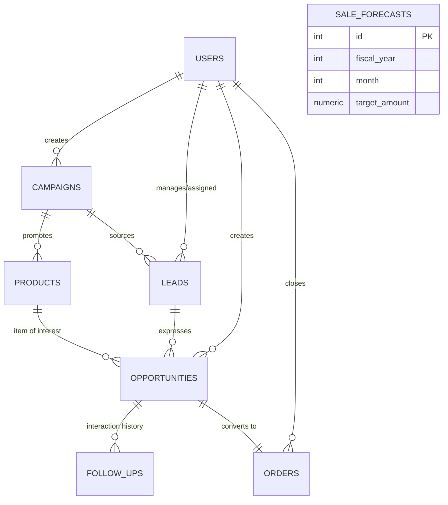

# BÁO CÁO PHÂN TÍCH YÊU CẦU PHẦN MỀM (SRS ANALYSIS SPECIFICATION)
> **Tài liệu gốc:** [CRM_SRS_Ver 1.1-Update-Aug-2020.docx](./CRM_SRS_Ver%201.1-Update-Aug-2020.docx)  
> **Đơn vị ban hành:** iViettech Education (Author: Viet Vy - Ver 1.1, Oct 24, 2019)  
> **Chuyên gia phân tích:** Senior Software Analyst  
> **Mục tiêu:** Bóc tách 100% yêu cầu chức năng, phi chức năng, luồng nghiệp vụ, thực thể, quy tắc ràng buộc và làm rõ các điểm mơ hồ (ambiguities) nhằm làm chuẩn mực cho toàn bộ hệ thống Zen CRM.

---

## 1. FUNCTIONAL REQUIREMENTS (YÊU CẦU CHỨC NĂNG)

Các yêu cầu chức năng được trích xuất trực tiếp từ Mục 2.1 (Product Features) và Mục 3 (System Features):

### 1.1. Quản lý Khách hàng tiềm năng (Lead Management - SRS 3.1 -> 3.5)
* **FR-LEAD-01 (SRS 3.1): Add a New Lead**
  * Hệ thống cho phép Nhân viên bán hàng nhập thông tin khách hàng tiềm năng gồm: Họ tên, địa chỉ, số điện thoại, email, ngày sinh, nghề nghiệp,... (3.1.1).
  * Biểu mẫu nhập phải hiển thị rõ ràng các trường bắt buộc (3.1.2 REQ-2).
  * Mọi dữ liệu phải được kiểm tra tính hợp lệ trước khi lưu vào CSDL (3.1.2 REQ-3).
  * Hệ thống phải giúp người dùng dễ dàng phát hiện dữ liệu trùng lặp (3.1.2 REQ-4).
* **FR-LEAD-02 (SRS 3.2): View the Leads**
  * Mặc định hiển thị 20 khách hàng tiềm năng mới nhất trên trang đầu tiên, cho phép chuyển sang các trang khác (3.2.3 REQ-1).
  * Cho phép sắp xếp danh sách theo ngày nhập (`entered date`) (3.2.3 REQ-2).
  * Cho phép lọc danh sách theo ngày nhập (`entered date`) (3.2.3 REQ-3).
  * Khi chọn 1 Lead, hệ thống hiển thị chi tiết thông tin Lead, từ đó cho phép sửa, xóa và thêm Cơ hội bán hàng (Opportunity) cho Lead đó (3.2.3 REQ-4).
* **FR-LEAD-03 (SRS 3.3): Search a Lead by name**
  * Cho phép người dùng nhập toàn bộ tên hoặc một phần tên vào ô tìm kiếm; kết quả hiển thị trên danh sách View of Lead (3.3.3 REQ-1).
  * Chọn một kết quả tìm kiếm sẽ hiển thị màn hình chi tiết Lead để sửa, xóa, hoặc thêm Cơ hội (3.3.3 REQ-2).
* **FR-LEAD-04 (SRS 3.4): Edit a Lead**
  * Cho phép nhấn nút Edit từ màn hình chi tiết Lead (kết quả của Search hoặc View) (3.4.3 REQ-1).
  * Toàn bộ thông tin cập nhật mới phải được xác thực hợp lệ (3.4.3 REQ-2).
* **FR-LEAD-05 (SRS 3.5): Delete a Lead**
  * Cho phép nhấn nút Delete từ màn hình xem hoặc tìm kiếm (3.5.3 REQ-1).
  * Bản ghi Lead sẽ bị xóa hoàn toàn khỏi cơ sở dữ liệu (3.5.3 REQ-2).

---

### 1.2. Quản lý Cơ hội bán hàng (Opportunity Management - SRS 3.6 -> 3.12)
* **FR-OPP-01 (SRS 3.6): Add a New Opportunity**
  * Cho phép tạo Cơ hội bán hàng mới chứa thông tin Lead, Sản phẩm mà khách hàng quan tâm, ngày tạo cơ hội, số lượng,... (3.6.1 & 3.6.2 REQ-1).
  * Biểu mẫu phải chỉ rõ các trường bắt buộc (3.6.2 REQ-2).
  * Dữ liệu phải được xác thực trước khi lưu vào CSDL (3.6.2 REQ-3).
  * Hệ thống phải hỗ trợ người dùng dễ dàng tìm kiếm/phát hiện thông tin trùng lặp (3.6.2 REQ-4).
* **FR-OPP-02 (SRS 3.7): View Opportunity**
  * Mặc định hiển thị 20 Cơ hội mới nhất trên trang đầu tiên, hỗ trợ phân trang (3.7.3 REQ-1).
  * Sắp xếp danh sách theo ngày nhập (3.7.3 REQ-2).
  * Lọc danh sách theo ngày nhập (3.7.3 REQ-3).
  * Khi chọn 1 Cơ hội, hiển thị thông tin chi tiết; từ đó cho phép Sửa, Xóa, Thêm nhật ký Follow up và Chốt đơn hàng (Make an Order) (3.7.3 REQ-4).
* **FR-OPP-03 (SRS 3.8): Search Opportunity**
  * Cho phép nhập tên/một phần tên của Lead hoặc Sản phẩm vào ô tìm kiếm (3.8.3 REQ-1).
  * Chọn kết quả tìm kiếm để xem chi tiết, sửa, xóa, thêm follow up và make order (3.8.3 REQ-2).
* **FR-OPP-04 (SRS 3.9): Edit an Opportunity**
  * Cho phép nhấn nút Edit từ màn hình chi tiết; mọi thông tin mới phải được kiểm tra hợp lệ (3.9.3 REQ-1, REQ-2).
* **FR-OPP-05 (SRS 3.10): Delete an Opportunity**
  * Cho phép nhấn nút Delete; Cơ hội bị xóa khỏi CSDL (3.10.3 REQ-1, REQ-2).
* **FR-OPP-06 (SRS 3.11): Follow up an Opportunity**
  * Nhân viên ghi nhận hoạt động tương tác với khách qua gọi điện thoại hoặc gửi email giới thiệu sản phẩm (3.11.1).
  * Thông tin lưu trữ gồm: Ngày liên hệ (`date`), nội dung (`content of follow`), phản hồi của khách (`response of customer`), kế hoạch tiếp theo (`next plan`) (3.11.3 REQ-1).
  * Dữ liệu follow up hiển thị và có thể xem lại bất cứ lúc nào ở màn hình chi tiết Cơ hội; tất cả dữ liệu phải được xác thực hợp lệ (3.11.3 REQ-1, REQ-2).
* **FR-OPP-07 (SRS 3.12): Make an Order**
  * Chuyển đổi trạng thái của Opportunity thành Order (3.12.1).
  * Bổ sung các thông tin gồm: Ngày chốt đơn (`date to make Order`), thông tin thanh toán (`Payment information`), thông tin giao hàng (`shipping information...`) (3.12.3 REQ-1).

---

### 1.3. Quản lý Tài khoản & Cá nhân (User Profile Management - SRS 3.13, 3.14)
* **FR-AUTH-01 (SRS 3.13): Login, Logout, Update Profile**
  * Cho phép người dùng đăng nhập hệ thống dựa trên thông tin định danh và nhận vai trò (role) tương ứng (3.13.1, 5.3).
  * Đăng xuất khỏi hệ thống.
  * Cập nhật thông tin hồ sơ cá nhân (profile).
* **FR-AUTH-02 (SRS 3.14): Forget Password**
  * Người dùng nhập địa chỉ email đã đăng ký vào hệ thống và nhấn nút "Reset Password" (3.14.3 REQ-1).
  * Hệ thống kiểm tra email nhập vào và email trong hệ thống; nếu trùng khớp, gửi một liên kết (link) qua email để cho phép người dùng đặt lại mật khẩu mới (3.14.3 REQ-2).

---

### 1.4. Quản lý Sản phẩm (Product Management - SRS 3.15 -> 3.17)
* **FR-PROD-01 (SRS 3.15): Add / Edit / Delete / Search Product**
  * Yêu cầu tương tự như Lead Management (Thêm sản phẩm, Danh sách hiển thị 20 SP mới nhất kèm phân trang, Lọc/Sắp xếp theo ngày, Tìm kiếm theo tên, Sửa, Xóa).
* **FR-PROD-02 (SRS 3.16): View Opportunity for Product**
  * Tại màn hình chi tiết sản phẩm, khi người dùng nhấn "View Opportunity", hệ thống hiển thị danh sách tất cả các Cơ hội bán hàng liên quan đến sản phẩm đó (3.16.3 REQ-1).
* **FR-PROD-03 (SRS 3.17): View Order for Product**
  * Tại màn hình chi tiết sản phẩm, hệ thống cho phép xem danh sách tất cả các Đơn hàng liên quan đến sản phẩm đó (3.17 REQ-1).

---

### 1.5. Quản lý Chiến dịch (Campaign Management - SRS 3.18, 3.19)
* **FR-CAMP-01 (SRS 3.18): Add / Edit / Delete / Search Campaign**
  * Thông tin chiến dịch bao gồm: Tên chiến dịch (`name of campaign`), mô tả (`description`), ngày bắt đầu (`date start`), ngày kết thúc (`date end`), ngân sách (`budget`) (3.18.1).
  * Khi người dùng thêm sản phẩm, họ có thể chọn một chiến dịch để gán sản phẩm vào chiến dịch đó (3.18.1).
  * Các tính năng Thêm/Sửa/Xóa/Tìm kiếm tương tự như Lead Management (3.18.2).
* **FR-CAMP-02 (SRS 3.19): Campaign Performance Report**
  * Báo cáo thống kê số lượng Lead và Opportunity thu được từ chiến dịch (3.19.1).
  * Khi chọn 1 chiến dịch và nhấn "View Campaign Performance Report by Lead", hệ thống liệt kê toàn bộ danh sách Lead đến từ chiến dịch đó (3.19.3 REQ-1).

---

### 1.6. Dự báo & Kế hoạch Doanh số (Sale Forecast and Planning - SRS 3.20, 3.21)
* **FR-FORE-01 (SRS 3.20): Setup a New Plan**
  * Cung cấp biểu mẫu cho phép người dùng nhập định mức doanh thu dự báo cho 12 tháng trong năm (từ Tháng 1 đến Tháng 12, đơn vị $) (3.20.3 REQ-1).
* **FR-FORE-02 (SRS 3.21): Performance Report**
  * Thu thập dữ liệu thực tế trên hệ thống và đối chiếu với kế hoạch đã lập để xuất bảng báo cáo đối soát 12 tháng gồm các cột: `Month` | `Plan($)` | `Actually Value($)` | `%` (3.21.3 REQ-1).

---

### 1.7. Hệ thống Báo cáo tổng hợp (General Reports - SRS 2.1)
*(SRS ghi chú rõ: "Requirement is not described. You can define them")*
* **FR-REP-01 (SRS 2.1):** Báo cáo số lượng Lead theo ngày hiện tại, Tháng, Năm (Report Lead by current day, Month, Year).
* **FR-REP-02 (SRS 2.1):** Báo cáo số lượng Đơn hàng theo ngày hiện tại, Tháng, Năm (Report Order by current day, Month, Year).
* **FR-REP-03 (SRS 2.1):** Báo cáo Doanh thu theo ngày hiện tại, Tháng, Năm chi tiết theo từng sản phẩm (Report Revenue by current day, Month, Year follow product).

---

### 1.8. Quản trị Người dùng & Phân quyền (Administration - SRS 2.1)
*(SRS ghi chú rõ: "Requirement is not described. You can define them")*
* **FR-ADM-01 (SRS 2.1):** Danh sách tất cả người dùng trong hệ thống (List All Users).
* **FR-ADM-02 (SRS 2.1):** Tạo tài khoản người dùng mới (Create New User).
* **FR-ADM-03 (SRS 2.1):** Đặt lại mật khẩu người dùng (Reset Password).
* **FR-ADM-04 (SRS 2.1):** Khóa hoặc kích hoạt người dùng (Active / De-active User).
* **FR-ADM-05 (SRS 2.1):** Gán vai trò cho người dùng (Assign user role: ADMIN, SALE_MANAGER, SALESMAN).

---

## 2. NON-FUNCTIONAL REQUIREMENTS (YÊU CẦU PHI CHỨC NĂNG)

Dựa trên Mục 2.2 và Mục 5 của SRS:

| Mã NFR | Phân nhóm | Mô tả chi tiết trong SRS | Hiện thực kỹ thuật cam kết |
| :--- | :--- | :--- | :--- |
| **NFR-ENV-01** | **Môi trường hoạt động (SRS 2.2)** | "System will run on the Internet and can adapt with almost any popular browser." | Web responsive trên Chrome, Firefox, Safari, Edge (Desktop & Tablet). |
| **NFR-SEC-01** | **Xác thực & Vai trò (SRS 5.3)** | "Users must login and get a role in the system. System only allows the user to do actions based on role." | JWT Authentication, Middleware phân quyền RBAC đa cấp độ (ADMIN, SALE_MANAGER, SALESMAN). |
| **NFR-SEC-02** | **Session Timeout (SRS 5.3)** | "System will timeout automatically if there are no actions during 30 minutes." | Hook theo dõi sự kiện tương tác (`mousemove`, `keydown`, `click`). Nếu 30 phút bất hoạt, tự hủy Token và chuyển hướng về Login. |
| **NFR-UI-01** | **Giao diện người dùng (SRS 4.1)** | "Refer to www.zoho.com/crm or any CRM site to get a mockup for the system." | Thiết kế giao diện hiện đại phong cách Zoho CRM, tông màu xám slate/xanh navy, bảng 20 dòng, modal mượt mà. |
| **NFR-PERF-01** | **Hiệu năng (SRS 5.1)** | "Not defined" *(SRS để trống, bổ sung theo chuẩn công nghiệp)* | Thời gian phản hồi API < 500ms; Database đánh Index cho `entered_date`, `phone`, `email`. |
| **NFR-SAFE-01** | **An toàn dữ liệu (SRS 5.2)** | "Not defined" *(SRS để trống, bổ sung theo chuẩn công nghiệp)* | Toàn vẹn dữ liệu qua Transaction ACID khi chốt đơn trừ tồn kho (`makeOrder`); mật khẩu băm bcrypt 10 rounds. |
| **NFR-QUAL-01** | **Chất lượng mã nguồn (SRS 5.4)**| "Not defined" *(SRS để trống, bổ sung theo chuẩn công nghiệp)* | Kiến trúc MVC rõ ràng; RESTful chuẩn HTTP status codes; code dễ bảo trì. |

---

## 3. ACTORS (CÁC TÁC NHÂN HỆ THỐNG)

Trích xuất trực tiếp từ Mục 1.4 (Term) và Mục 2.1 (Overall Description):

1. **Nhân viên bán hàng (Sales man):**
   * Định nghĩa (1.4): Người sử dụng CRM để quản lý và chăm sóc khách hàng qua điện thoại, mạng xã hội hoặc website.
   * Phạm vi (2.1): Quản lý Leads (3.1-3.5), Quản lý Opportunities (3.6-3.10), Follow up khách hàng (3.11), Chốt đơn hàng Make an Order (3.12), Quản lý Profile cá nhân (3.13-3.14).
2. **Quản lý bán hàng (Sale manager):**
   * Định nghĩa (1.4): Người thiết lập sản phẩm và quản lý đội ngũ nhân viên bán hàng.
   * Phạm vi (2.1): Kế thừa quyền xem Leads/Opps; Quản lý Sản phẩm (3.15-3.17), Quản lý Chiến dịch (3.18-3.19), Lập kế hoạch dự báo doanh thu Sale Forecast & đối soát (3.20-3.21), Xem hệ thống Báo cáo tổng hợp (2.1).
3. **Quản trị viên hệ thống (Administrator):**
   * Định nghĩa (1.4): Người quản lý người dùng trên hệ thống CRM.
   * Phạm vi (2.1): Quản lý User/Role (danh sách user, tạo mới, reset password, kích hoạt/khóa tài khoản, gán role), toàn quyền truy cập dữ liệu hệ thống.
4. **Hệ thống tự động / Bộ đếm thời gian (System Timer):**
   * Tác nhân ngầm định theo dõi thời gian không thao tác của phiên làm việc để kích hoạt tự động Đăng xuất sau 30 phút (SRS 5.3).
5. **Dịch vụ Mail bên ngoài (External SMTP Mail Service):**
   * Tác nhân tích hợp nhận lệnh gửi thư chứa liên kết đặt lại mật khẩu khi người dùng yêu cầu Quên mật khẩu (SRS 3.14).

---

## 4. MAIN USER FLOWS (CÁC LUỒNG NGƯỜI DÙNG CHÍNH)

### 4.1. Luồng Xác thực, Quên mật khẩu & Tự động Đăng xuất (Auth & Session Flow)
1. **Đăng nhập:** Người dùng nhập username/password -> Hệ thống kiểm tra -> Cấp JWT Token kèm User Role -> Điều hướng về Dashboard tương ứng.
2. **Quên mật khẩu (SRS 3.14):** Người dùng bấm "Forget Password" -> Nhập email -> Hệ thống kiểm tra email tồn tại -> Sinh token reset có hạn 15 phút -> Gửi link qua SMTP -> Người dùng bấm link mở form nhập mật khẩu mới -> Cập nhật hash trong CSDL.
3. **Tự động Timeout (SRS 5.3):** Trong quá trình sử dụng, nếu người dùng không tương tác chuột/phím trong 30 phút -> Bộ lắng nghe phát hiện -> Xóa token trên bộ nhớ client -> Chuyển về màn hình đăng nhập với thông báo hết phiên.

### 4.2. Luồng Vòng đời Lead & Kiểm tra Trùng lặp (Lead Lifecycle Flow - SRS 3.1 -> 3.5)
1. **Thu thập:** Sales man nhận thông tin khách từ web/chiến dịch -> Mở form "Add a New Lead".
2. **Xác thực & Trùng lặp (REQ-3, REQ-4):** Hệ thống kiểm tra các trường bắt buộc; kiểm tra SĐT/Email đã có trong CSDL chưa -> Nếu trùng, cảnh báo; nếu hợp lệ, tạo bản ghi mới với `entered_date = NOW()`.
3. **Tra cứu & Sắp xếp (SRS 3.2, 3.3):** Xem danh sách 20 dòng mới nhất -> Lọc hoặc Sắp xếp theo `entered_date` -> Tìm kiếm nhanh theo tên.
4. **Chi tiết & Thao tác tiếp nối (SRS 3.2.3 REQ-4):** Bấm chọn Lead -> Màn hình chi tiết hiển thị đầy đủ thông tin cá nhân và danh sách các Cơ hội (Opportunities) của khách hàng đó -> Tại đây có nút Sửa, Xóa hoặc Thêm Cơ hội mới.

### 4.3. Luồng Chăm sóc Cơ hội & Chốt đơn hàng (Opportunity to Order Flow - SRS 3.6 -> 3.12)
1. **Khởi tạo:** Sales man tạo Cơ hội bán hàng: Chọn Lead + Chọn Sản phẩm quan tâm + Số lượng + Ngày dự kiến.
2. **Theo dõi tương tác (Follow up - SRS 3.11):** Sales man liên hệ khách (gọi điện thoại/email) -> Mở Cơ hội -> Thêm bản ghi Follow up gồm: Ngày liên hệ, Nội dung trao đổi, Phản hồi khách hàng, Kế hoạch tiếp theo -> Hệ thống lưu vết lịch sử tương tác.
3. **Chốt đơn (Make an Order - SRS 3.12):** Khách đồng ý mua -> Sales man bấm "Make an Order" -> Nhập thông tin thanh toán, địa chỉ nhận hàng, ngày chốt đơn -> Hệ thống thực hiện Transaction: Kiểm tra số lượng tồn kho sản phẩm, trừ tồn kho, cập nhật trạng thái Cơ hội thành `ORDERED`, tạo bản ghi Đơn hàng mới (`orders`).

### 4.4. Luồng Quản trị Sản phẩm & Đối soát Đơn hàng (Product Tracking Flow - SRS 3.15 -> 3.17)
1. Sale Manager tạo sản phẩm (Mã SP, tên, giá, số lượng kho, chọn Chiến dịch quảng bá nếu có).
2. Vào chi tiết sản phẩm -> Nhấn "View Opportunity" để xem toàn bộ danh sách khách hàng đang quan tâm SP này (SRS 3.16).
3. Nhấn "View Order" để xem toàn bộ các đơn hàng thực tế đã xuất bán sản phẩm này (SRS 3.17).

### 4.5. Luồng Quản trị Chiến dịch & Đo lường Hiệu quả (Campaign Performance Flow - SRS 3.18, 3.19)
1. Sale Manager tạo Chiến dịch: Tên, mô tả, ngày bắt đầu, ngày kết thúc, ngân sách (`budget`).
2. Gán sản phẩm vào chiến dịch (SRS 3.18.1); Gán Lead thu thập được từ chiến dịch (1.4).
3. Xem báo cáo hiệu quả chiến dịch (SRS 3.19): Chọn chiến dịch -> Xem thống kê số lượng Lead và Cơ hội thu về -> Bấm "View Campaign Performance Report by Lead" để xem bảng danh sách toàn bộ Leads thu thập từ chiến dịch.

### 4.6. Luồng Lập Kế hoạch & Báo cáo Đối soát Doanh số (Forecast Flow - SRS 3.20, 3.21)
1. **Thiết lập Kế hoạch (SRS 3.20):** Đầu năm tài chính, Sale Manager mở form "Setup a New Plan" -> Nhập chỉ tiêu doanh số dự báo cho 12 tháng (Tháng 1 -> 12, đơn vị $).
2. **Báo cáo Đối soát Thực tế (SRS 3.21):** Vào "Performance Report" -> Hệ thống tự động tính tổng doanh thu từ các đơn hàng thực tế theo từng tháng (`Actually Value`) -> Đối chiếu với chỉ tiêu `Plan` -> Tính tỷ lệ phần trăm hoàn thành (`% = Actually / Plan * 100%`) -> Hiển thị bảng đối soát 12 dòng và biểu đồ trực quan.

---

## 5. BUSINESS RULES (CÁC QUY TẮC RÀNG BUỘC NGHIỆP VỤ)

| Mã quy tắc | Tên quy tắc | Căn cứ SRS | Đặc tả chi tiết |
| :--- | :--- | :--- | :--- |
| **BR-01** | **Chống trùng lặp dữ liệu (Duplicate Detection)** | SRS 3.1.2 REQ-4 & 3.6.2 REQ-4 | - **Với Lead:** Không cho phép lưu Lead có `email` hoặc `phone` đã tồn tại trong CSDL. Biểu mẫu phải báo lỗi rõ ràng. - **Với Opportunity:** Cảnh báo khi tạo cùng 1 cặp (Lead, Product) nếu cơ hội trước đó chưa hoàn thành/đóng. |
| **BR-02** | **Quy chuẩn hiển thị & phân trang** | SRS 3.2.3 REQ-1 & 3.7.3 REQ-1 | Mặc định hiển thị đúng **20 bản ghi mới nhất** trên trang đầu tiên theo ngày nhập giảm dần (`entered_date DESC`). Cung cấp nút chuyển trang (Pagination). |
| **BR-03** | **Toàn vẹn chuyển đổi đơn hàng (Make an Order)** | SRS 3.12.3 REQ-1 | Chuyển đổi trạng thái Cơ hội sang `ORDERED` phải thực hiện đồng thời với việc tạo `Order` và kiểm tra trừ `stock_qty` của Sản phẩm trong 1 Transaction CSDL duy nhất. Nếu kho không đủ, phải Rollback và báo lỗi. |
| **BR-04** | **Lưu vết tương tác khách hàng (Follow up Log)** | SRS 3.11.3 REQ-1 | Nhật ký chăm sóc là lịch sử chỉ thêm (Append-only). Mỗi bản ghi bắt buộc có đủ: Ngày thực hiện, Kênh/Nội dung, Phản hồi khách hàng, Kế hoạch tiếp theo. |
| **BR-05** | **Thời hạn phiên làm việc (Session Idle Timeout)** | SRS 5.3 | Phiên đăng nhập tự động hủy sau **30 phút** nếu không có hành động chuột/bàn phím. Người dùng bị buộc đăng xuất về trang đăng nhập. |
| **BR-06** | **Ràng buộc trường bắt buộc (Form Validation)** | SRS 3.1.2 REQ-2, REQ-3 & 3.6.2 REQ-2, REQ-3 | Biểu mẫu phải đánh dấu `*` ở các trường bắt buộc; Backend validate 100% dữ liệu trước khi INSERT/UPDATE. |
| **BR-07** | **Toán tử so sánh Kế hoạch vs Thực tế** | SRS 3.21.3 REQ-1 | Tỷ lệ `% = (Actually Value / Plan Value) * 100`. Nếu `Plan = 0`, `% = 0%`. `Actually Value` tính từ tổng tiền các đơn hàng trong tháng. |
| **BR-08** | **Nguyên tắc phân quyền 3 cấp độ (RBAC)** | SRS 5.3 & 2.1 | - `SALESMAN`: Thao tác trực tiếp với Lead, Opportunity, Follow-up, Order. - `SALE_MANAGER`: Quản lý Product, Campaign, Forecast, Xem báo cáo tổng hợp. - `ADMIN`: Toàn quyền quản trị tài khoản nhân viên (User/Role). |

---

## 6. EXTERNAL DEPENDENCIES (CÁC PHỤ THUỘC BÊN NGOÀI)

1. **SMTP Server / Mail Provider (SRS 3.14):**
   * Hệ thống phụ thuộc vào cổng SMTP gửi thư (như Gmail SMTP, SendGrid hoặc Mailtrap) để thực hiện tính năng "Forget Password". Cần cấu hình an toàn bằng Application Password trong file môi trường.
2. **Cơ sở dữ liệu PostgreSQL:**
   * Động cơ CSDL lưu trữ quan hệ chuẩn 3NF, hỗ trợ Row-level locking và Transaction ACID cho chức năng Make an Order.
3. **Môi trường Trình duyệt Web (Web Browser Environment - SRS 2.2):**
   * Đòi hỏi hỗ trợ các tiêu chuẩn web hiện đại (HTML5, ES6+, Fetch/XHR, LocalStorage/Cookie cho lưu trữ token).
4. **Tài liệu tham khảo giao diện (SRS 1.3 & 4.1):**
   * Dẫn chiếu thiết kế UI/UX theo tiêu chuẩn Zoho CRM ([www.zoho.com/crm](https://www.zoho.com/crm)).

---

## 7. DATA ENTITIES (MÔ HÌNH THỰC THỂ DỮ LIỆU CHUẨN 3NF)

Dựa trên toàn bộ các thuộc tính được nhắc tới trong SRS:

### Chi tiết các thực thể:
1. **User (`users` - SRS 1.4, 2.1, 3.13, 5.3):**
   * Thuộc tính: `id`, `username`, `email`, `password_hash`, `full_name`, `phone`, `role` (`ADMIN`, `SALE_MANAGER`, `SALESMAN`), `is_active`, `reset_password_token`, `reset_password_expires`, `created_at`, `updated_at`.
2. **Lead (`leads` - SRS 1.4, 3.1 -> 3.5):**
   * Thuộc tính: `id`, `first_name`, `last_name`, `email`, `phone`, `date_of_birth`, `career`, `address`, `campaign_id` (FK), `assigned_to` (FK users), `entered_date`, `updated_at`.
3. **Campaign (`campaigns` - SRS 1.4, 3.18, 3.19):**
   * Thuộc tính: `id`, `name`, `description`, `start_date`, `end_date`, `budget`, `created_by` (FK users), `created_at`.
4. **Product (`products` - SRS 1.4, 3.15 -> 3.17):**
   * Thuộc tính: `id`, `product_code`, `name`, `description`, `unit_price`, `stock_qty`, `campaign_id` (FK), `created_at`.
5. **Opportunity (`opportunities` - SRS 1.4, 3.6 -> 3.12):**
   * Thuộc tính: `id`, `lead_id` (FK), `product_id` (FK), `quantity`, `expected_close_date`, `status` (`NEW`, `CONTACTED`, `QUALIFIED`, `PROPOSAL`, `ORDERED`, `LOST`), `notes`, `created_by` (FK users), `created_at`.
6. **FollowUp (`follow_ups` - SRS 1.4, 3.11):**
   * Thuộc tính: `id`, `opportunity_id` (FK), `follow_date`, `contact_method` (Phone/Email), `content`, `customer_response`, `next_plan`, `created_by` (FK users).
7. **Order (`orders` - SRS 1.4, 3.12, 3.17):**
   * Thuộc tính: `id`, `order_code`, `opportunity_id` (FK unique), `lead_id` (FK), `product_id` (FK), `quantity`, `unit_price`, `total_amount`, `order_date`, `payment_info`, `shipping_address`, `status` (`PENDING`, `COMPLETED`, `CANCELLED`), `created_by` (FK users).
8. **SaleForecast (`sale_forecasts` - SRS 3.20, 3.21):**
   * Thuộc tính: `id`, `fiscal_year`, `month` (1-12), `target_amount`, `created_by` (FK users), `updated_at`.

---

## 8. API REQUIREMENTS (DANH MỤC RESTFUL APIS ĐẶC TẢ THEO SRS)

| Phân hệ | HTTP Verb | Endpoint | Quyền hạn | Mô tả chức năng SRS |
| :--- | :--- | :--- | :--- | :--- |
| **Auth** | POST | `/api/auth/login` | Public | Đăng nhập, trả về JWT & thông tin vai trò (SRS 3.13, 5.3) |
| | POST | `/api/auth/forgot-password` | Public | Gửi email link reset mật khẩu (SRS 3.14) |
| | POST | `/api/auth/reset-password` | Public | Đặt lại mật khẩu mới qua mã xác thực (SRS 3.14) |
| | GET | `/api/auth/me` | Authenticated | Lấy thông tin user hiện tại |
| | PUT | `/api/auth/profile` | Authenticated | Cập nhật thông tin profile cá nhân (SRS 3.13) |
| **Admin** | GET | `/api/admin/users` | ADMIN | Danh sách tất cả người dùng (SRS 2.1) |
| | POST | `/api/admin/users` | ADMIN | Tạo tài khoản người dùng mới (SRS 2.1) |
| | PATCH | `/api/admin/users/:id/status`| ADMIN | Kích hoạt / Khóa tài khoản (Active/Deactive) (SRS 2.1) |
| | POST | `/api/admin/users/:id/reset` | ADMIN | Quản trị viên reset mật khẩu (SRS 2.1) |
| | PUT | `/api/admin/users/:id/role` | ADMIN | Gán vai trò cho tài khoản (Assign user role) (SRS 2.1) |
| **Leads** | GET | `/api/leads` | SALESMAN, MANAGER, ADMIN | Danh sách 20 Leads, sort date, filter date, search name (SRS 3.2, 3.3) |
| | POST | `/api/leads` | SALESMAN, MANAGER, ADMIN | Thêm mới Lead (kiểm tra trùng lặp & bắt buộc) (SRS 3.1) |
| | GET | `/api/leads/:id` | SALESMAN, MANAGER, ADMIN | Chi tiết Lead kèm danh sách Opportunity liên quan (SRS 3.2.3 REQ-4) |
| | PUT | `/api/leads/:id` | SALESMAN, MANAGER, ADMIN | Chỉnh sửa Lead kèm validate (SRS 3.4) |
| | DELETE | `/api/leads/:id` | SALESMAN, MANAGER, ADMIN | Xóa Lead khỏi cơ sở dữ liệu (SRS 3.5) |
| **Opportunities** | GET | `/api/opportunities` | SALESMAN, MANAGER, ADMIN | Danh sách 20 Opps, sort date, filter date, search tên (SRS 3.7, 3.8) |
| | POST | `/api/opportunities` | SALESMAN, MANAGER, ADMIN | Thêm Cơ hội bán hàng (Lead + Product) (SRS 3.6) |
| | GET | `/api/opportunities/:id` | SALESMAN, MANAGER, ADMIN | Chi tiết Cơ hội + Lịch sử Follow-up (SRS 3.7) |
| | PUT | `/api/opportunities/:id` | SALESMAN, MANAGER, ADMIN | Sửa Cơ hội (SRS 3.9) |
| | DELETE | `/api/opportunities/:id` | SALESMAN, MANAGER, ADMIN | Xóa Cơ hội (SRS 3.10) |
| | POST | `/api/opportunities/:id/follow-ups`| SALESMAN, MANAGER | Thêm Follow-up: ngày, nội dung, phản hồi, kế hoạch tiếp (SRS 3.11) |
| | POST | `/api/opportunities/:id/make-order`| SALESMAN, MANAGER | Make an Order: chuyển status, trừ kho, tạo Order bằng DB Transaction (SRS 3.12) |
| **Orders** | GET | `/api/orders` | SALESMAN, MANAGER, ADMIN | Danh sách đơn hàng đã chốt |
| | GET | `/api/orders/:id` | SALESMAN, MANAGER, ADMIN | Chi tiết đơn hàng, thanh toán, giao hàng (SRS 3.12) |
| **Products** | GET | `/api/products` | Tất cả roles | Danh mục sản phẩm, tìm kiếm tên/mã (SRS 3.15) |
| | POST | `/api/products` | SALE_MANAGER, ADMIN | Thêm sản phẩm mới (SRS 3.15) |
| | PUT | `/api/products/:id` | SALE_MANAGER, ADMIN | Chỉnh sửa sản phẩm (SRS 3.15) |
| | DELETE | `/api/products/:id` | SALE_MANAGER, ADMIN | Xóa sản phẩm (SRS 3.15) |
| | GET | `/api/products/:id/opportunities`| SALE_MANAGER, ADMIN | Xem tất cả Cơ hội liên quan đến sản phẩm này (SRS 3.16) |
| | GET | `/api/products/:id/orders` | SALE_MANAGER, ADMIN | Xem tất cả Đơn hàng liên quan đến sản phẩm này (SRS 3.17) |
| **Campaigns** | GET | `/api/campaigns` | SALE_MANAGER, ADMIN | Danh sách và tìm kiếm chiến dịch (SRS 3.18) |
| | POST | `/api/campaigns` | SALE_MANAGER, ADMIN | Thêm chiến dịch mới (SRS 3.18) |
| | PUT | `/api/campaigns/:id` | SALE_MANAGER, ADMIN | Sửa thông tin chiến dịch (SRS 3.18) |
| | DELETE | `/api/campaigns/:id` | SALE_MANAGER, ADMIN | Xóa chiến dịch (SRS 3.18) |
| | GET | `/api/campaigns/:id/report` | SALE_MANAGER, ADMIN | Báo cáo số Lead & Opp thu được từ chiến dịch (SRS 3.19) |
| **Forecast** | POST | `/api/forecasts/setup` | SALE_MANAGER, ADMIN | Nhập chỉ tiêu dự báo 12 tháng của năm tài chính (SRS 3.20) |
| | GET | `/api/forecasts/performance` | SALE_MANAGER, ADMIN | Bảng đối soát Plan vs Actually Value vs % 12 tháng (SRS 3.21) |
| **Reports** | GET | `/api/reports/leads` | SALE_MANAGER, ADMIN | Thống kê Lead theo Ngày hiện tại / Tháng / Năm (SRS 2.1) |
| | GET | `/api/reports/orders` | SALE_MANAGER, ADMIN | Thống kê Order theo Ngày hiện tại / Tháng / Năm (SRS 2.1) |
| | GET | `/api/reports/revenue` | SALE_MANAGER, ADMIN | Thống kê Doanh thu theo Ngày / Tháng / Năm theo từng sản phẩm (SRS 2.1) |

---

## 9. ACCEPTANCE CRITERIA (TIÊU CHÍ NGHIỆM THU TESTABLE)

* **AC-LEAD-01 (Phân trang 20 dòng - SRS 3.2.3 REQ-1):**
  * *Given* hệ thống có 35 Leads,
  * *When* Sales man mở màn hình View the Leads,
  * *Then* bảng hiển thị chính xác 20 Leads mới nhất xếp theo `entered_date DESC`, và thanh phân trang hiển thị tổng cộng 2 trang.
* **AC-LEAD-02 (Chặn trùng lặp SĐT/Email - SRS 3.1.2 REQ-4):**
  * *Given* Lead "Nguyễn Văn A" đã tồn tại với email `a@example.com` và SĐT `0901234567`,
  * *When* người dùng tạo Lead mới có email hoặc SĐT trùng lặp,
  * *Then* hệ thống từ chối lưu và hiển thị thông báo lỗi cảnh báo dữ liệu bị trùng.
* **AC-OPP-01 (Nhật ký Follow up - SRS 3.11):**
  * *Given* một Cơ hội bán hàng đang mở,
  * *When* Sales man thêm một bản ghi Follow up với đầy đủ ngày, nội dung, phản hồi khách hàng và kế hoạch tiếp theo,
  * *Then* dữ liệu được lưu thành công và xuất hiện trong lịch sử chăm sóc của Cơ hội đó.
* **AC-ORDER-01 (Make an Order & Trừ tồn kho - SRS 3.12):**
  * *Given* Cơ hội đang ở trạng thái `NEW` với sản phẩm Laptop có tồn kho 5 chiếc, số lượng đặt là 2,
  * *When* người dùng thực hiện "Make an Order" với thông tin thanh toán và địa chỉ giao hàng hợp lệ,
  * *Then* trạng thái Cơ hội chuyển thành `ORDERED`, một đơn hàng mới được tạo với tổng tiền chính xác, và tồn kho sản phẩm tự động giảm về 3.
* **AC-ORDER-02 (Make an Order khi hết hàng):**
  * *Given* sản phẩm chỉ còn tồn kho 1 chiếc, nhưng Cơ hội yêu cầu 2 chiếc,
  * *When* người dùng bấm "Make an Order",
  * *Then* hệ thống báo lỗi không đủ tồn kho và không thay đổi trạng thái Cơ hội, không trừ kho.
* **AC-AUTH-01 (Tự động Timeout 30 phút - SRS 5.3):**
  * *Given* người dùng đã đăng nhập hệ thống,
  * *When* không có thao tác chuột, bàn phím nào trong suốt 30 phút liên tục,
  * *Then* phiên làm việc hết hạn, token bị xóa và màn hình tự động chuyển về trang Login.
* **AC-FORE-01 (Báo cáo Plan vs Actual - SRS 3.21):**
  * *Given* Kế hoạch Tháng 1 là $15,000 và tổng đơn hàng thực tế trong Tháng 1 là $15,000,
  * *When* người dùng mở báo cáo Performance Report,
  * *Then* dòng Tháng 1 hiển thị: Plan = 15,000, Actually Value = 15,000, % = 100%.

---

## 10. AMBIGUITIES AND MISSING INFORMATION (CÁC ĐIỂM MƠ HỒ & GIẢI PHÁP ĐỀ XUẤT)

Dưới đây là 10 điểm mơ hồ / thiếu sót được phát hiện trực tiếp trong tài liệu SRS Version 1.1, kèm trích dẫn nguyên văn, lý do và phương án làm rõ:

### 1. Thiếu đặc tả chi tiết cho Hệ thống Báo cáo (SRS 2.1 vs Section 3)
* **Trích dẫn nguyên văn (SRS line 112):**
  > *"Report (Requirement is not described. You can define them): Report Lead by current day, Month, Year / Report Order by current day, Month, Year / Report Revenue by current day, Month, Year follow product"*
* **Lý do mơ hồ:** SRS nêu tên 3 loại báo cáo ở bảng tính năng tổng quan (Mục 2.1) nhưng không hề có mục con tương ứng trong Mục 3 (System Features) để quy định cấu trúc bộ lọc, định dạng bảng hay biểu đồ.
* **Đề xuất làm rõ:**
  * Xây dựng trang Báo cáo chung (`GeneralReports.jsx`) cho Sale Manager.
  * Cung cấp các nút chuyển đổi (Tab / Date Range Picker): "Hôm nay", "Tháng này", "Năm nay".
  * Kết hợp biểu đồ trực quan (Chart.js) và bảng số liệu phân tách theo từng sản phẩm.

### 2. Thiếu đặc tả chi tiết cho Phân hệ Quản trị viên (SRS 2.1 vs Section 3)
* **Trích dẫn nguyên văn (SRS line 117):**
  > *"Manage User/Role (Requirement is not described. You can define them): List All Users / Create New User / Reset Password / Active/De-active User / Assign user role"*
* **Lý do mơ hồ:** SRS liệt kê 5 tính năng quản trị tài khoản của Administrator tại Mục 2.1 nhưng bỏ trống toàn bộ phần đặc tả chi tiết trong Mục 3.
* **Đề xuất làm rõ:**
  * Hiện thực module Admin chuyên biệt với trang `UserManagement.jsx`.
  * Hỗ trợ bảng danh sách nhân viên, modal tạo user mới với mật khẩu mặc định, nút toggle trạng thái Active/Inactive, nút Reset Password, và dropdown gán vai trò (`SALESMAN` / `SALE_MANAGER` / `ADMIN`).

### 3. Tiêu chí xác định "Dữ liệu trùng lặp" (SRS 3.1.2 REQ-4 & 3.6.2 REQ-4)
* **Trích dẫn nguyên văn:**
  > *"REQ-4: The system must help users easily find the duplicate information."* (Xuất hiện ở cả Mục 3.1 Lead và Mục 3.6 Opportunity).
* **Lý do mơ hồ:** SRS không định nghĩa rõ trường dữ liệu nào dùng làm căn cứ trùng lặp (tên, số điện thoại, email hay địa chỉ?), và hành vi hệ thống là "chặn tuyệt đối" hay chỉ "hiển thị cảnh báo gợi ý".
* **Đề xuất làm rõ:**
  * **Đối với Lead:** Căn cứ trùng lặp chuẩn công nghiệp là `phone` hoặc `email`. Hệ thống chặn trùng lặp tuyệt đối khi lưu (Unique check) và hiển thị cảnh báo đỏ trên form khi người dùng vừa nhập xong.
  * **Đối với Opportunity:** Căn cứ trùng lặp là một cặp (Lead, Product) nếu đã có một cơ hội chưa kết thúc. Hệ thống hiển thị cảnh báo để tránh nhân viên tạo trùng cơ hội bán cùng 1 món đồ cho cùng 1 khách.

### 4. Lỗi đánh máy (Typo) ở màn hình Chi tiết Cơ hội (SRS 3.7.3 REQ-4 & 3.8.3 REQ-2)
* **Trích dẫn nguyên văn (SRS line 186 & 194):**
  > *"REQ-4: When the user selects a Lead the system will display detailed information of Opportunity. Then the user can edit, delete, add follow up information and make an order from the Opportunity."*
* **Lý do mơ hồ:** Trong mục "3.7 Opportunity Management – View Opportunity" và "3.8 Opportunity Management – Search", SRS lại viết là *"When the user selects a Lead"* thay vì *"selects an Opportunity"*.
* **Đề xuất làm rõ:**
  * Đây là lỗi sao chép văn bản (copy-paste typo) của tác giả SRS từ mục Lead sang.
  * Hiểu chuẩn xác: Khi người dùng chọn một **Cơ hội (Opportunity)** trên danh sách thì hệ thống mở chi tiết Cơ hội đó để thao tác.

### 5. Hành vi nghiệp vụ khi Chốt đơn hàng "Make an Order" (SRS 3.12)
* **Trích dẫn nguyên văn (SRS line 225):**
  > *"REQ-1: Convert the status of Opportunity to Order and add more information like date to make Order, Payment information, shipping information…"*
* **Lý do mơ hồ:** SRS không nói rõ sau khi "convert", bản ghi Opportunity có bị xóa khỏi CSDL hay không, và đơn hàng có trừ tồn kho sản phẩm hay không.
* **Đề xuất làm rõ:**
  * Bản ghi Opportunity **không được xóa** mà chuyển `status` sang `'ORDERED'` để giữ toàn vẹn lịch sử tư vấn.
  * Đồng thời tạo mới 1 bản ghi trong bảng `orders` (liên kết 1-1 với opportunity).
  * Trừ số lượng tồn kho (`stock_qty`) của sản phẩm tương ứng trong một DB Transaction an toàn.

### 6. Sai tiêu đề phân mục Quản lý Sản phẩm (SRS 3.16 & 3.17)
* **Trích dẫn nguyên văn (SRS line 243 & 250):**
  > *"User Profile management – View Opportunity for product"*  
  > *"User Profile management – View Order for product"*
* **Lý do mơ hồ:** Hai tính năng này mang tiêu đề "User Profile management", nhưng nội dung lại là xem cơ hội và đơn hàng theo sản phẩm (`Product Management`), thuộc vai trò của Sale Manager chứ không phải Profile cá nhân.
* **Đề xuất làm rõ:**
  * Đây là lỗi đặt sai tiêu đề chương trong SRS.
  * Hai tính năng này thuộc phân hệ **Product Management** của Sale Manager: Đặt tại màn hình chi tiết sản phẩm (`ProductDetail.jsx`) gồm 2 tab: "Cơ hội liên quan" và "Đơn hàng liên quan".

### 7. Mối quan hệ giữa Chiến dịch, Sản phẩm và Khách hàng (SRS 3.18 vs 3.19)
* **Trích dẫn nguyên văn:**
  > *"When users add a product, they can select a campaign to add this product to the campaign."* (3.18.1)  
  > *"This function is reports how many opportunities or leads collected from this campaign."* (3.19.1)
* **Lý do mơ hồ:** SRS 3.18.1 chỉ nhắc tới việc gán Sản phẩm vào Chiến dịch, nhưng Mục 1.4 Term lại định nghĩa Chiến dịch là *"program of marketing to collect the Lead information"* và Mục 3.19 yêu cầu báo cáo danh sách Lead từ chiến dịch.
* **Đề xuất làm rõ:**
  * Thiết kế CSDL hỗ trợ cả hai: Bảng `leads` có khóa ngoại `campaign_id` (Lead đến từ chiến dịch nào), và bảng `products` có khóa ngoại `campaign_id` (Sản phẩm được quảng bá trong chiến dịch nào).

### 8. Phạm vi Năm tài chính trong Kế hoạch Doanh số (SRS 3.20)
* **Trích dẫn nguyên văn (SRS line 270):**
  > *"REQ-1: Design a form to users can enter a forecast revenue like below table... Month (1 -> 12) | Value($)"*
* **Lý do mơ hồ:** Bảng mẫu chỉ liệt kê từ Tháng 1 đến Tháng 12 mà không có cột hoặc trường chọn Năm (`Fiscal Year`). Nếu không có năm, hệ thống chỉ lưu được kế hoạch của một năm duy nhất và không thể lưu trữ lịch sử qua các năm.
* **Đề xuất làm rõ:**
  * Thêm trường `fiscal_year` (ví dụ: 2024, 2025, 2026) vào bảng CSDL `sale_forecasts`. Biểu mẫu cho phép chọn Năm tài chính trước khi nhập chỉ tiêu 12 tháng.

### 9. Nguồn tính toán của "Actually Value($)" trong Báo cáo Đối soát (SRS 3.21)
* **Trích dẫn nguyên văn (SRS line 294):**
  > *"Create the report like below table: Month | Plan($) | Actually Value($) | %"*
* **Lý do mơ hồ:** SRS không nêu công thức tính hay nguồn dữ liệu để lấy ra "Actually Value".
* **Đề xuất làm rõ:**
  * `Actually Value` trong Tháng $M$ của Năm $Y$ được tính bằng tổng tiền của tất cả các đơn hàng thành công trong tháng đó:  
    $$\text{Actually Value} = \sum \text{orders.total\_amount} \quad \text{với } \text{EXTRACT(MONTH FROM order\_date)} = M \text{ và } \text{YEAR} = Y$$
  * `%` = $(\text{Actually Value} / \text{Plan}) \times 100$.

### 10. Các yêu cầu phi chức năng bị bỏ trống ("Not defined" trong SRS 5.1, 5.2, 5.4)
* **Trích dẫn nguyên văn (SRS line 314 - 321):**
  > *"5.1 Performance Requirements: Not defined"*  
  > *"5.2 Safety Requirements: Not defined"*  
  > *"5.4 Software Quality Attributes: Not defined"*
* **Lý do mơ hồ:** SRS để trống 3 mục phi chức năng quan trọng của một phần mềm chuẩn nghiệp vụ.
* **Đề xuất làm rõ:**
  * Thiết lập SLA chuẩn mực công nghiệp cho đồ án:
    * **Hiệu năng:** Thời gian phản hồi API $\le 500$ms, hỗ trợ phân trang 20 dòng, đánh chỉ mục (`INDEX`) các trường thường xuyên lọc/sắp xếp (`entered_date`, `created_at`, `phone`, `email`).
    * **An toàn & Toàn vẹn:** Dùng PostgreSQL Transactions cho chốt đơn; mật khẩu người dùng băm an toàn bằng `bcryptjs` (salt rounds = 10); chống SQL Injection qua parameterized queries `$1, $2`.
    * **Bảo mật phiên làm việc (SRS 5.3):** Thực thi nghiêm ngặt cơ chế đếm ngược 30 phút bất hoạt để hủy phiên và đăng xuất.
